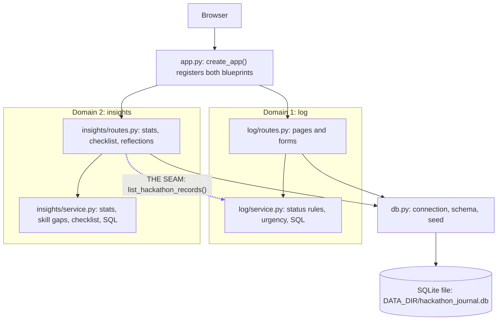
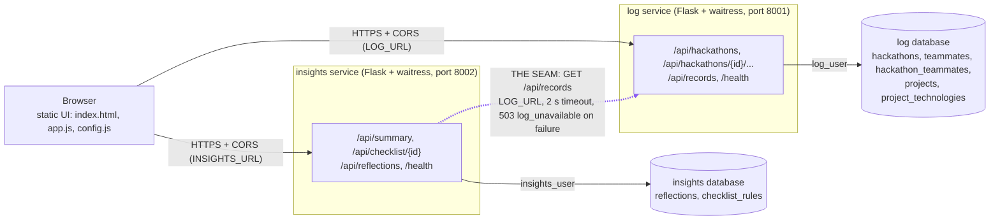
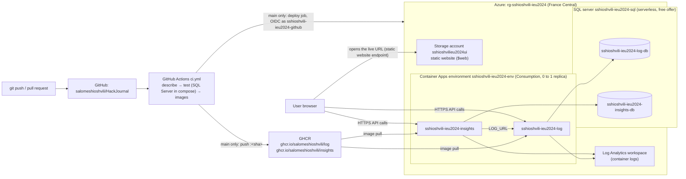

# Architecture

## Before: Assignment 1 monolith

The dotted arrow is the seam. Insights imports exactly one thing from log: `list_hackathon_records()`, which returns a list of plain dictionaries (each with its projects and teammates, including the hackathon `id`). Log never imports insights.

## After: two services and a static UI (Assignment 2)

The seam is in the same place as in Assignment 1 (ADR 2, ADR 6): the function call became `GET /api/records`. Each service connects only to its own database with its own login. Locally both databases live in one SQL Server container; on Azure each is its own serverless database on one logical server.

## Deployment

