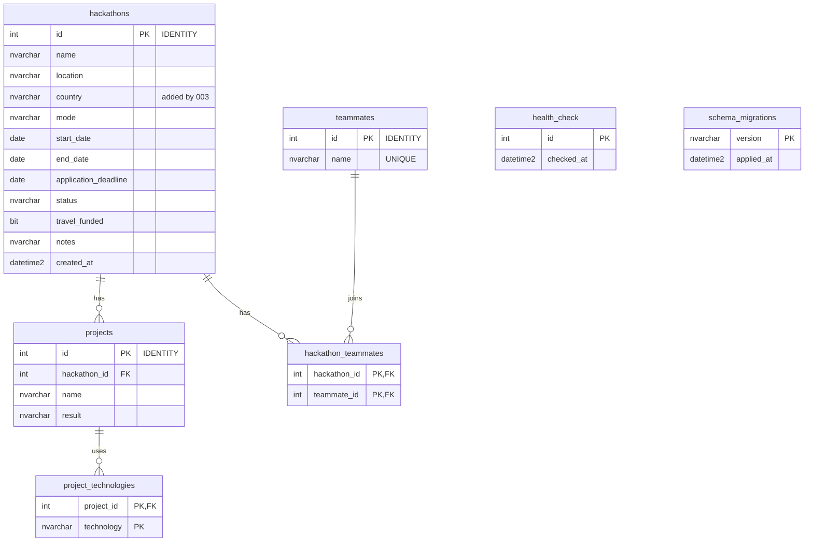
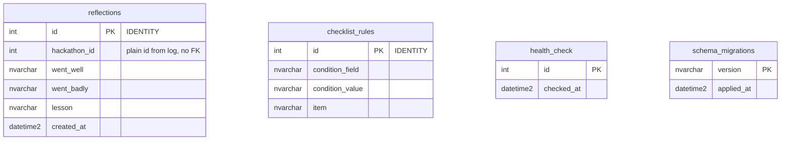

# Database schema per service

Each service owns its own database. The tables come from the numbered files in `services/<name>/migrations/`, and both databases also have a `schema_migrations` table that records which files have run.

## log database (`log_db` locally, `sshioshvili-ieu2024-log-db` on Azure)

Migrations: `001_init.sql` (tables), `002_health_check.sql` (health_check), `003_add_country.sql` (adds `country` to hackathons and fills it from `location`).

## insights database (`insights_db` locally, `sshioshvili-ieu2024-insights-db` on Azure)

Migrations: `001_init.sql` (tables), `002_health_check.sql` (health_check).

`reflections.hackathon_id` points at `hackathons.id` in the other database, so SQL can't enforce it. Insights checks it in code instead: before saving a reflection it fetches the record from log and only accepts an attended hackathon (ADR 7). `checklist_rules` has a unique constraint on (condition_field, condition_value, item).
